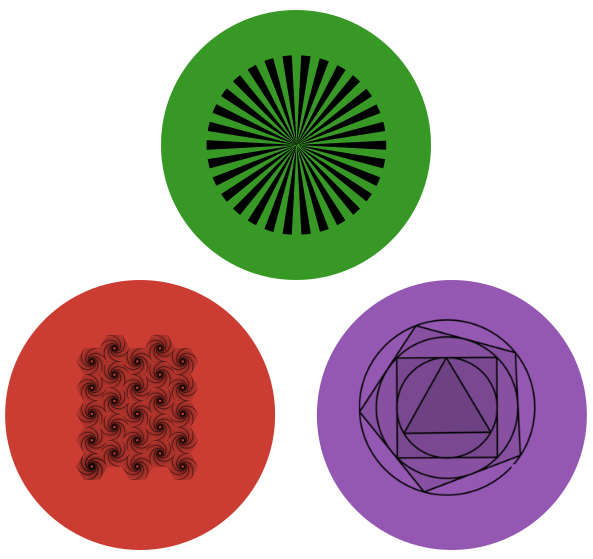

# PatternVectors.jl 
[](https://rcalxrc08.github.io/PatternVectors.jl/)
[](https://github.com/rcalxrc08/PatternVectors.jl/actions/workflows/CI.yml)
[](https://codecov.io/gh/rcalxrc08/PatternVectors.jl)

PatternVectors.jl provides `PatternVector`, an immutable `AbstractVector` that stores a vector with a known
structure (a handful of values and the rules for where they go) instead of storing every element.

## Why

Numerical code is full of long vectors that hold only a few distinct values:
quadrature weights (`[1, 4, 2, 4, 2, …, 4, 1] / 3` for Simpson's rule), alternating signs, boundary values on a
grid, a payoff that is different only at maturity, and so on. The usual options both have a cost:

- **materializing a dense vector** uses O(n) memory, and every broadcast over it evaluates the function n times;
- **writing an index loop** (`ifelse(isodd(i), …)`) is fast on the CPU, but it does not run on GPUs without a
  kernel, and it is awkward for automatic differentiation.

A `PatternVector` keeps the vectorized style and removes the cost:

- it stores only its length and the pattern values, so it is a small `isbits` object that can be sent to a GPU
  kernel as is;
- a broadcast over `PatternVector`s evaluates the function once per distinct value and returns a `PatternVector`;
- a broadcast mixing `PatternVector`s and other arrays (`Array`, `CuArray`, …) returns an array of the other
  type, computed in a single fused pass, on CPU and GPU alike;
- `sum` and indexing with ranges are O(1) and return the expected types;
- it is differentiable with Zygote, Mooncake and Enzyme; with Mooncake and Enzyme the gradient with respect to a
  `PatternVector` is accumulated directly on its pattern values, never on a dense vector.

## Available patterns

| Pattern | Elements | Minimum length |
|---|---|---|
| `ZeroPattern(x)` | `[0, 0, 0, 0, …]` (zero of the type of `x`) | 1 |
| `FillPattern(a)` | `[a, a, a, a, …]` | 1 |
| `InitialValuePattern(a, b)` | `[a, b, b, b, …]` | 2 |
| `FinalValuePattern(a, b)` | `[a, a, a, …, a, b]` | 2 |
| `PaddedFillPattern(x, a, y)` | `[x, a, a, …, a, y]` | 3 |
| `EvenOddPattern(a, b)` | `[a, b, a, b, …]` (`a` at odd, `b` at even indices) | 2 |
| `PaddedEvenOddPattern(x, a, b, y)` | `[x, a, b, a, b, …, y]` (`a` at even, `b` at odd inner indices) | 4 |

A vector is built from a length and a pattern: `PatternVector(n, pattern)`. New patterns can be added outside the
package (see [Defining a new pattern](#defining-a-new-pattern)).

## How to install

```julia
using Pkg
Pkg.add(url = "https://github.com/rcalxrc08/PatternVectors.jl")
```

and to run the tests:

```julia
Pkg.test("PatternVectors")
```

## Example of usage

```julia
using PatternVectors
x = PatternVector(10, EvenOddPattern(0.2, 2.3))            # [0.2, 2.3, 0.2, 2.3, …]
z = PatternVector(10, PaddedEvenOddPattern(0.2, -2.0, 4.0, 2.3))
y = randn(10)

sin.(x)                 # PatternVector: sin is evaluated twice
@. sin(x) + exp(z)      # PatternVector: patterns are combined
@. sin(x) * y + z       # Vector{Float64}: one fused loop
z[2:2:8]                # PatternVector (ranges keep the pattern)
sum(z)                  # O(1)
```

Simpson's rule without index loops, on CPU or GPU:

```julia
simpson(f_x, h) = h * sum(PatternVector(length(f_x), PaddedEvenOddPattern(1/3, 4/3, 2/3, 1/3)) .* f_x)
```

### GPU

Being `isbits`, a `PatternVector` mixes with GPU arrays without any specialization and without scalar indexing:

```julia
using PatternVectors, CUDA
CUDA.allowscalar(false)
x = PatternVector(10, EvenOddPattern(0.2f0, 2.3f0))
z = PatternVector(10, PaddedEvenOddPattern(0.2f0, -2.0f0, 4.0f0, 2.3f0))
y = cu(randn(Float32, 10))
@. sin(x) * y + z       # CuArray
```

## Automatic differentiation

| Backend | Support | Gradient w.r.t. a `PatternVector` |
|---|---|---|
| [Zygote.jl](https://github.com/FluxML/Zygote.jl) | ChainRules rules shipped with the package | a `PatternVector` for expressions involving only patterns, a dense vector when mixed with dense arrays |
| [Mooncake.jl](https://github.com/chalk-lab/Mooncake.jl) | package extension, with a dedicated rule for broadcasts mixing `PatternVector`s and arrays (CPU and CUDA) | a structural tangent holding the gradient of the pattern fields |
| [Enzyme.jl](https://github.com/EnzymeAD/Enzyme.jl) | works natively, no extension needed | pass the vector as `Active`: the result is a `PatternVector` whose `.pattern` holds the gradient |

```julia
using PatternVectors, Zygote
f(a, b, x) = sum(sin.(PatternVector(length(x), EvenOddPattern(a, b))) .* x)
Zygote.gradient(f, 0.3, 0.5, rand(100))

v = PatternVector(10^12, PaddedEvenOddPattern(1.0, 2.0, 3.0, 4.0))
Zygote.gradient(v -> sum(v .* v), v)   # immediate, despite the 10^12 elements
```

With Enzyme, a `PatternVector` is an immutable struct: pass it as `Active` (a `Duplicated` shadow stays zero),
and pass constant dense arrays as `Duplicated` or enable `set_runtime_activity`, as for any broadcast in Enzyme.

## Performance

Weights `w = [a, b, c, b, c, …, d]` built from four scalars, either as a dense vector (`[a, b, c, d][idx]`) or as
`PatternVector(n, PaddedEvenOddPattern(a, b, c, d))`; gradients with respect to `a, b, c, d` and, when present, the dense `x`.
n = 10^5, Julia 1.13, Intel i7-8550U, single thread; all gradients agree across backends.

| Computation | Storage of `w` | Forward | Zygote | Mooncake | Enzyme |
|---|---|---|---|---|---|
| `sum(w .* x)` | dense | 273 µs | 1.35 ms | 8.62 ms | 1.16 ms |
| | PatternVector | 116 µs | 603 µs | 1.09 ms | 508 µs |
| `sum(sin.(w .* x) .* exp.(w))` | dense | 2.11 ms | 5.22 ms | 13.3 ms | 6.64 ms |
| | PatternVector | 1.19 ms | 3.36 ms | 4.28 ms | 3.48 ms |
| `sum(exp.(w) .* w)` | dense | 932 µs | 2.67 ms | 9.80 ms | 3.27 ms |
| | PatternVector | 61 ns | 1.6 µs | 447 ns | 155 ns |

The last row involves only the PatternVector: its cost does not depend on n (the same timings at n = 10^3).

The PatternVector is never materialized: `exp.(w)` is evaluated four times instead of n, and the gradient of the
pattern values is accumulated in registers instead of on a dense vector. The script is
[`etc/benchmarks.jl`](etc/benchmarks.jl).

A broader suite, covering every pattern with several element types (Float16, Float64, irrationals, dual numbers),
functions and gradients, is in [`benchmark`](benchmark) and runs on CI, which prints its summary tables:

```sh
julia --project=benchmark benchmark/runbenchmarks.jl
```

## Defining a new pattern

A pattern is an immutable struct subtyping `AbstractPattern{T}`. The methods below are all that is needed; as an
example, a pattern repeating three values, `[a, b, c, a, b, c, …]`:

```julia
using PatternVectors, ChainRulesCore
import PatternVectors: AbstractPattern, ArrayStylePatternVector, pattern_minimum_size, getindex_pattern,
    getindex_pattern_range, materialize_pattern, flat_index, determine_mixed_pattern, pattern_to_vector_pullback

struct CyclicPattern{T} <: AbstractPattern{T}
    a::T
    b::T
    c::T
end

# 1. Smallest length the pattern is defined for
pattern_minimum_size(::CyclicPattern) = 3

# 2. Element at index `ind` of a vector of length `n`
getindex_pattern(x::CyclicPattern, ind::Int, ::Int) = (x.a, x.b, x.c)[mod1(ind, 3)]

# 3. Indexing with a range: returns the new length and pattern
getindex_pattern_range(x::CyclicPattern, r::AbstractRange{Int}, n::Int) =
    length(r), CyclicPattern(ntuple(k -> getindex_pattern(x, r[k], n), 3)...)

# 4. Broadcast: evaluate the function once per distinct value (`flat_index(arg, k)` is element k of any argument)
function materialize_pattern(bc::Base.Broadcast.Broadcasted{ArrayStylePatternVector{P}}) where {P <: CyclicPattern}
    bc_f = Broadcast.flatten(bc)
    n = length(first(Broadcast.combine_axes(bc_f.args...)))
    return n, CyclicPattern(ntuple(k -> bc_f.f(flat_index.(bc_f.args, k)...), 3)...)
end

# 5. Pattern resulting from broadcasting with other patterns (UnknownPattern, i.e. no result, otherwise)
determine_mixed_pattern(::Type{<:CyclicPattern{L}}, ::Type{<:CyclicPattern{M}}) where {L, M} = CyclicPattern{promote_type(L, M)}
determine_mixed_pattern(::Type{<:FillPattern{L}}, ::Type{<:CyclicPattern{M}}) where {L, M} = CyclicPattern{promote_type(L, M)}
determine_mixed_pattern(::Type{<:ZeroPattern{L}}, ::Type{<:CyclicPattern{M}}) where {L, M} = CyclicPattern{promote_type(L, M)}

# 6. Optional but recommended: O(1) sum (the default iterates over all elements)
function Base.sum(x::PatternVector{T, <:CyclicPattern}) where {T}
    q, r = divrem(x.n, 3)
    return (q + (r >= 1)) * x.pattern.a + (q + (r >= 2)) * x.pattern.b + q * x.pattern.c
end
```

`determine_mixed_pattern` is checked in both argument orders, so each pair is defined once.

**Automatic differentiation.** Enzyme needs nothing more. `pattern_to_vector_pullback` maps a cotangent vector
`Δ` (dense or `PatternVector`) onto the pattern fields: Zygote always needs it, together with the rule for the
constructor; Mooncake needs it when the pattern is broadcast together with arrays other than `Array` (e.g.
`CuArray`), while with `Array`s its rule differentiates `getindex_pattern` directly.

```julia
function ChainRulesCore.rrule(::Type{CyclicPattern}, a, b, c)
    CyclicPattern_pb(Δ) = NoTangent(), Δ.a, Δ.b, Δ.c
    return CyclicPattern(a, b, c), CyclicPattern_pb
end

function pattern_to_vector_pullback(::Type{<:CyclicPattern{T}}, Δ, n) where {T}
    o, z = one(T), zero(T)
    return CyclicPattern(sum(Δ .* PatternVector(n, CyclicPattern(o, z, z))),
                         sum(Δ .* PatternVector(n, CyclicPattern(z, o, z))),
                         sum(Δ .* PatternVector(n, CyclicPattern(z, z, o))))
end
```

The patterns in [`src/patterns`](src/patterns) follow the same structure.

## Similar packages

- [FillArrays.jl](https://github.com/JuliaArrays/FillArrays.jl): lazy constant arrays (`Fill`, `Zeros`, `Ones`)
  of any dimension, the multidimensional counterpart of `FillPattern` and `ZeroPattern`.
- [LazyArrays.jl](https://github.com/JuliaArrays/LazyArrays.jl): lazy concatenations and broadcasts; a padded
  vector can be written as `Vcat(x, Fill(a, n - 2), y)`, though broadcasts over it are not reduced to the distinct
  values and alternating layouts are not covered.
- [SparseArrays](https://github.com/JuliaSparse/SparseArrays.jl): vectors that are zero except at a few indices.
- [StaticArrays.jl](https://github.com/JuliaArrays/StaticArrays.jl): `isbits` arrays of small, fixed size, for
  the opposite case (few elements, all different).

PatternVectors.jl targets structured vectors of arbitrary length, with broadcasting, GPU and AD support built in.
